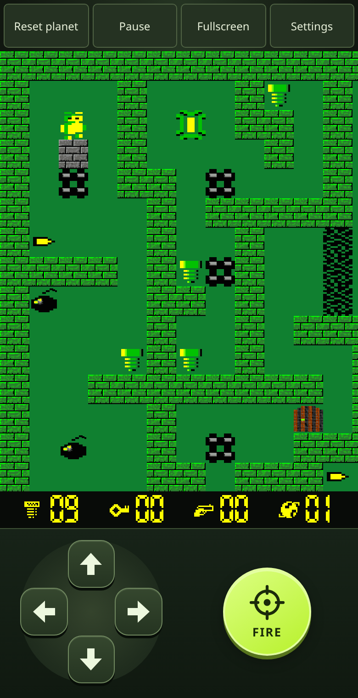
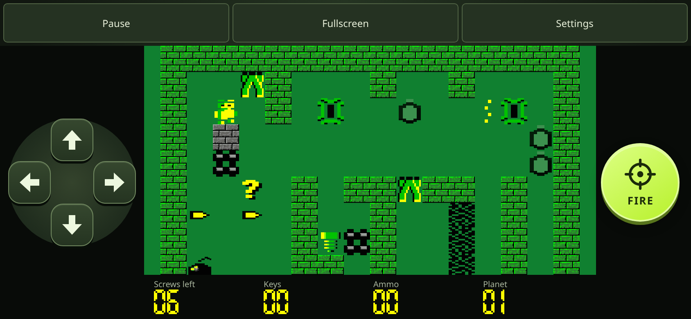
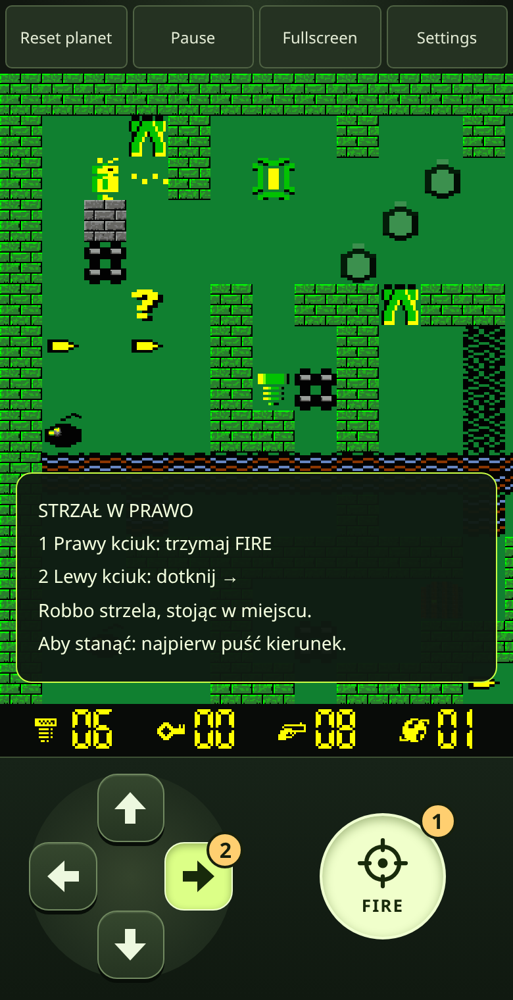
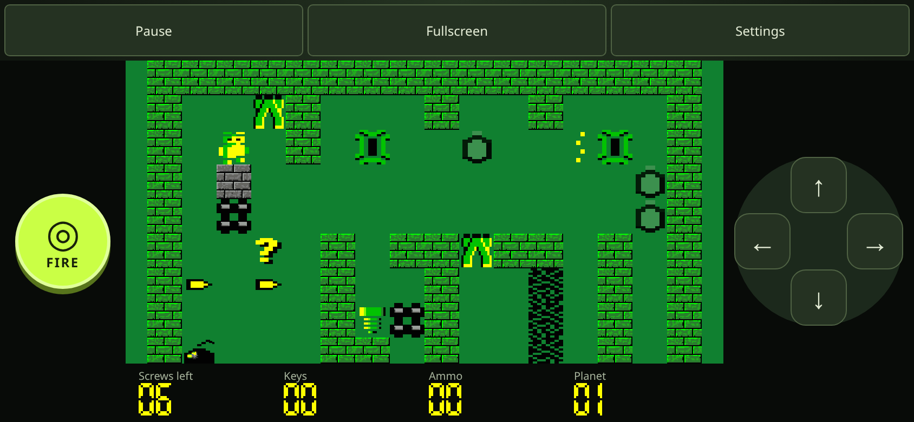
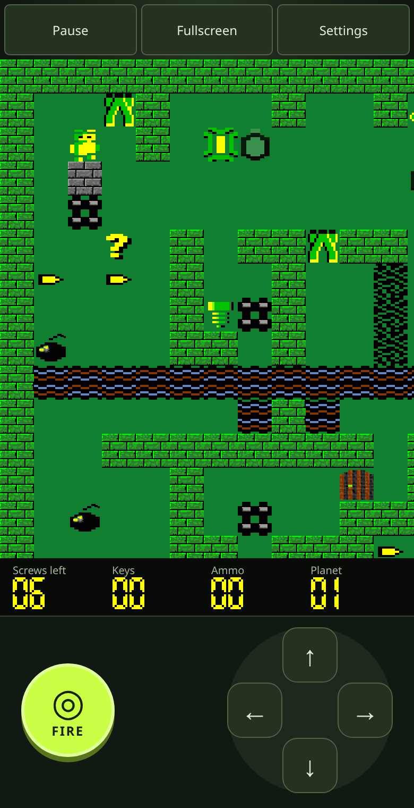

# Mobile controls

Robbo moves on a four-direction grid. A fixed D-pad under the left thumb and a
separate momentary fire button under the right thumb replace the old row of
labelled buttons. Settings → Touch layout lets players swap the two controls,
putting Fire under either thumb. The choice persists in the existing preferences
record; old records default to Fire on the right. Reset preferences restores that
default. Changing sides clears held inputs. Hold a direction to repeat movement, or slide the same finger
to turn. The centre and the area outside the pad release movement. Hold Fire
and aim to shoot; releasing Fire resumes movement. To stop shooting without moving, release the direction
first. Fire alone neither fires nor selects a direction. There are no diagonal moves.

Portrait reserves a control deck below the board. Landscape phones reserve side
rails, keeping both thumbs off the game tiles. The camera still follows Robbo at
the existing tile size. Safe-area padding is inherited from the play container.
The D-pad targets are 52 × 52 CSS pixels; Fire is 88 × 88. Pressed directions and
Fire show immediate visual feedback. Pause stays in the top bar; Restart moves
to Settings on touch devices. Native button keyboard activation remains available.

The numbered callouts in this screenshot explain the gesture and are not part of
the game interface.

## Design references

- [Apple: Game controls](https://developer.apple.com/design/human-interface-guidelines/game-controls)
  describes virtual controls for movement-based touch games.
- [Android: Touch target size](https://support.google.com/accessibility/android/answer/7101858?hl=en-GB)
  recommends at least 48 × 48 dp targets. We use at least 48 CSS pixels for this
  web interface; native dp and CSS pixels are different units.

The D-pad and separate thumb zones are a design choice for this game's mechanics,
not a platform requirement. Physical-device playtesting is still needed to judge
comfort across hand sizes and browser gesture areas.

## Validation and screenshots

Run `npm run package`, `npm test`, `node tests/browser/input.check.cjs`,
`node tests/browser/viewport.check.cjs`, `node tests/browser/touch-shooting.check.cjs` and `node tests/browser/session.check.cjs`.
Input coverage includes native two-finger fire, cancellation, sliding direction
changes, the neutral centre, both saved thumb layouts, release, keyboard and gamepad regressions. Viewport
coverage checks portrait, landscape, desktop, fullscreen, target sizes and camera
visibility without changing simulation state.

After packaging, `node scripts/dev/capture-mobile.cjs` writes reproducible Chromium
screenshots to `artifacts/`. These are browser emulations, not physical phone captures.
