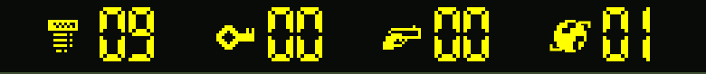

# Mobile controls

Settings → Touch movement switches between precise D-pad buttons (the default)
and a dedicated swipe surface beneath the board without restarting the planet.
The selection is saved automatically in the browser. A short
swipe gives one step. Drag at least 44 CSS pixels from the touch origin and hold
to repeat movement; return below 28 pixels to stop repeating, or to the neutral
centre to release the direction. Lift/cancel stops input without a movement
queue. Axis hysteresis reduces accidental turns from thumb wobble.

With D-pad buttons, tap for one step and hold for 280 ms to repeat.
Both movement modes support either thumb layout and the same Fire controls.

Tap Fire to shoot in Robbo's last facing direction, or hold it to repeat.
Holding Fire and a direction changes aim while Robbo remains still. To stop
in place, release the direction and then Fire; if a direction remains held
after Fire releases, movement can resume. Settings → Touch layout swaps the
movement and Fire zones and remembers the choice.

Portrait reserves a control deck below the board. Landscape phones reserve side
rails, keeping both thumbs off the game tiles. The camera still follows Robbo at
the existing tile size. Safe-area padding is inherited from the play container.
The D-pad targets range from 48 × 48 to 52 × 52 CSS pixels; Fire is 96 × 96.
Directions use 32 px SVG icons and Fire uses a 40 px crosshair, avoiding font
fallback and baseline differences on Android. Both thumb zones are centred in
equal-width portrait columns. Raised borders and an inset pressed state make
touch feedback visible without shifting the controls. Pressed directions and
Fire show immediate visual feedback. Pause and Reset planet stay in the top bar on touch devices. Reset immediately
restarts the current planet and clears its inventory, including while paused. Native button keyboard activation remains available.

The numbered callouts in this screenshot explain the gesture and are not part of
the game interface.

## Design references

- [Apple: Game controls](https://developer.apple.com/design/human-interface-guidelines/game-controls)
  describes virtual controls for movement-based touch games.
- [Android: Touch target size](https://support.google.com/accessibility/android/answer/7101858?hl=en-GB)
  recommends at least 48 × 48 dp targets. We use at least 48 CSS pixels for this
  web interface; native dp and CSS pixels are different units.

The D-pad and separate thumb zones are a design choice for this game's mechanics,
not a platform requirement. Physical-device playtesting is still needed to judge
comfort across hand sizes and browser gesture areas.

## Validation and screenshots

Run `npm run package`, `npm test`, `node tests/browser/input.check.cjs`,
`node tests/browser/viewport.check.cjs`, `node tests/browser/touch-shooting.check.cjs` and `node tests/browser/session.check.cjs`.
Input coverage includes native two-finger fire, cancellation, sliding direction
changes, the neutral centre, both saved thumb layouts, release, keyboard and gamepad regressions. Viewport
coverage checks portrait, landscape, desktop, fullscreen, target sizes and camera
visibility without changing simulation state.

After packaging, `node scripts/dev/capture-mobile.cjs` writes reproducible Chromium
screenshots to `artifacts/`. These are browser emulations, not physical phone captures.

## Original inventory strip

The [original Atari screenshots](https://www.atarimania.com/games/atari-400-800-xl-xe-games-robbo-4396)
show small item pictograms beside numbers, rather than written item names. The
web HUD follows that pattern for screws remaining, keys, ammo and the planet
number. Classic item markers come from the existing legacy atlas; a yellow
pixel globe marks the planet. Alternate themes use their own pickup artwork.
Names and extra collected/total information remain available to screen readers.
All four icons stay visible in portrait and landscape, including narrow phones.

